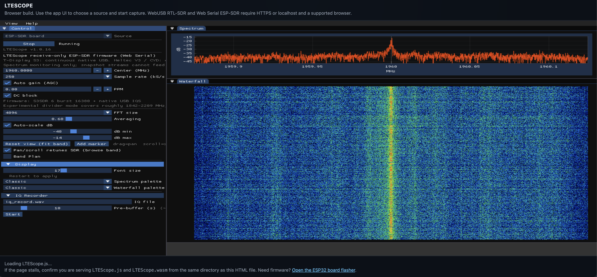
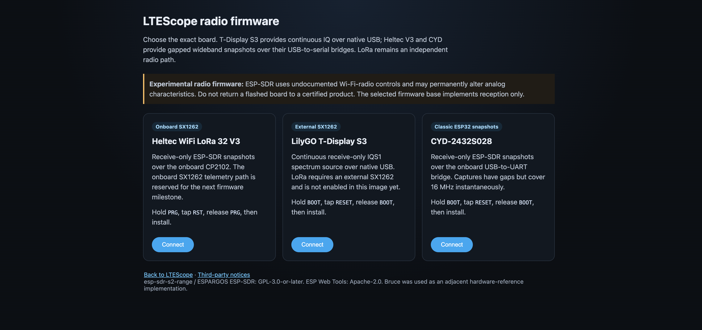

# LTEScope

LTEScope is a desktop SDR analysis app for spectrum viewing, waterfall display,
and protocol decode workflows.

Current direction:

- Native desktop first, with macOS now supported as a real build target.
- Optional SDR hardware backends for RTL-SDR, HackRF, and Airspy.
- LTE decoding stays vendored and optional through `HAS_LTE`.
- On macOS, LTE uses a direct srsRAN 4G backend. Falcon/LTESniffer stays on
  the non-macOS path for now.
- Emscripten/WebAssembly is experimental, but there is now a browser build
  path for RTL-SDR over WebUSB and receive-only ESP32 SDR monitoring over Web Serial.

The build is CMake-based and uses Ninja.

## Quick Start: ESP-SDR Web App

The browser build is the version that connects to the ESP32 boards over Web
Serial. From the repository root:



```bash
./scripts/start-web.sh
```

Open <http://localhost:8000/LTEScope.html> in desktop Chrome or Edge. In the
source selector choose **ESP-SDR board**, click **Start**, and select the board
in the browser's serial-device prompt. The firmware installer is available at
<http://localhost:8000/flash.html>. Stop the local server with `Ctrl-C`.

`start-web.sh` performs an incremental Emscripten build in `build-web/` before
serving it. Override its defaults with `BUILD_DIR=/path/to/build` or
`PORT=8080`.

## What You Need

### macOS

Recommended packages:

```bash
brew install llvm glfw zstd fftw pkg-config
```

LTEScope will fetch GLFW 3.4, ImGui, and ImPlot automatically if those sources
or packages are not available locally.

If Apple Clang on your machine is missing the full C++ standard library headers,
use Homebrew LLVM for the build.

### Windows

Use the MSYS2 MINGW64 shell and install the toolchain packages listed in
[`COMPILE.md`](COMPILE.md).

### Emscripten

This target emits `LTEScope.js`, `LTEScope.wasm`, the application page, and the
ESP32 flasher. It is the supported path for WebUSB/Web Serial radio access;
LTE decode is disabled in the browser build for now; the web target is focused
on spectrum/browser-radio and raw debug capture. The ESP32-S3 source uses the
`esp-sdr-s2-range` IQS1 protocol at up to 250 kS/s over native USB. UART boards
use gapped 16 MS/s snapshots. These modes can monitor LTE Band 2 spectrum, but
cannot provide a gapless full LTE channel to the decoder.

The normal build command is:

```bash
./scripts/build-emscripten.sh
```

To configure it manually with the Emscripten toolchain:

```bash
EM_CACHE="$PWD/build-emscripten/emcache" \
  emcmake cmake -S . -B build-emscripten -G Ninja \
  -DEMSCRIPTEN=ON -DHAS_LTE=OFF -DCMAKE_BUILD_TYPE=Release
```

If your Emscripten cache is not writable in the default location, point it at a
local directory before building:

```bash
EM_CACHE="$PWD/build-emscripten/emcache" \
  cmake --build build-emscripten -j4
```

The build must run from a browser, not `file://`. The recommended launcher is
`./scripts/start-web.sh`. To serve an existing default build manually:

```bash
cd build-emscripten
python3 -m http.server 8000
```

Then open `http://localhost:8000/LTEScope.html`. Web Serial requires a secure
context, so `localhost` is fine. Chrome or Edge desktop is required.

### ESP32-S3 / LoRa firmware and browser flasher



The receive-only targets are Heltec WiFi LoRa 32 V3, LilyGO T-Display S3, and
CYD-2432S028. T-Display uses continuous native-USB IQ; Heltec and CYD use
gapped wideband snapshots through their serial bridges. These first images are
headless: they do not initialize the Heltec OLED, CYD TFT, or T-Display LCD.
The spectrum and waterfall are rendered by the LTEscope web app. Build the
pinned firmware, then rebuild the web target:

```bash
./firmware/esp32-sdr/build.sh heltec-v3
# or: ./firmware/esp32-sdr/build.sh t-display-s3
# or: ./firmware/esp32-sdr/build.sh cyd
./scripts/build-emscripten.sh
```

Open `http://localhost:8000/flash.html` to install the generated image, then
return to LTEScope and choose **ESP-SDR board**. The firmware source, board and
LoRa matrix, transport, safety
notes, supported tuning range, and GPL obligations are documented in
[`firmware/esp32-sdr/README.md`](firmware/esp32-sdr/README.md) and
[`THIRD_PARTY_NOTICES.md`](THIRD_PARTY_NOTICES.md).

## Build

### Build Scripts

Use the helper scripts when you want a single command per target:

```bash
./scripts/build-mac.sh
./scripts/build-linux.sh
./scripts/build-emscripten.sh
```

The native scripts enable LTE and require RTL-SDR development files. The
Emscripten script disables LTE decode and builds the WebUSB RTL-SDR and
ESP-SDR bridge.

### macOS

From the project root:

```bash
cmake -S . -B build -G Ninja \
  -DCMAKE_C_COMPILER=/opt/homebrew/opt/llvm/bin/clang \
  -DCMAKE_CXX_COMPILER=/opt/homebrew/opt/llvm/bin/clang++
cmake --build build -j4
```

If your local Apple toolchain is complete, you can omit the `CMAKE_*_COMPILER`
flags and let CMake use the system compiler.

### Windows

From the MSYS2 MINGW64 shell:

```bash
cmake -S . -B build -G Ninja
ninja -C build
```

## Run

### macOS

```bash
./build/LTEScope
```

### Windows

```bash
./build/LTEScope.exe
```

### Emscripten

Run `./scripts/start-web.sh`, then open
`http://localhost:8000/LTEScope.html`. The app runs its main loop through
`emscripten_set_main_loop`, so it stays alive inside the browser tab.

## Build Options

- `HAS_LTE=ON|OFF`
- `HAS_AIRSPY` is enabled automatically when libairspy is found

Examples:

```bash
cmake -S . -B build -G Ninja -DHAS_LTE=OFF
cmake -S . -B build -G Ninja -DHAS_LTE=ON
```

## Notes

- RTL-SDR and HackRF support are optional. If the libraries are not present, the
  app still builds and the UI reports that hardware support is unavailable.
- On macOS, the OpenGL path is still desktop OpenGL. The build silences the
  platform deprecation warnings, but it is not using Metal.
- On macOS, the LTE path is srsRAN-only so the app can build and run without
  the Falcon/LTESniffer stack.
- If the repository checkout is missing vendor trees for GLFW, ImGui, or
  ImPlot, CMake will fetch them during configure.

## Before Committing

The firmware images and build directories are generated and ignored. A useful
pre-commit validation pass is:

```bash
bash -n firmware/esp32-sdr/build.sh scripts/build-emscripten.sh scripts/start-web.sh
node --check src/sdr/webesp_bridge.js
./scripts/build-emscripten.sh
git diff --check
git status --short
```

Firmware builds additionally require the pinned ESP-IDF revision described in
[`firmware/esp32-sdr/README.md`](firmware/esp32-sdr/README.md).

## More Detail

For the longer platform-specific dependency list and troubleshooting notes, see
[`COMPILE.md`](COMPILE.md).
